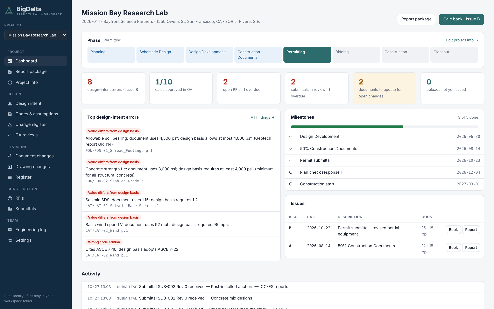
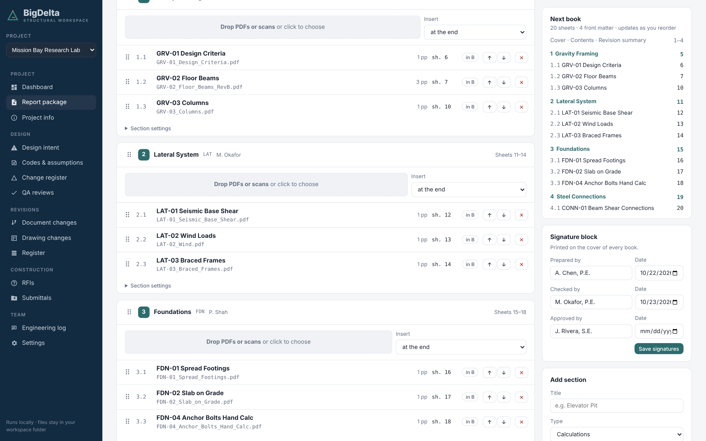
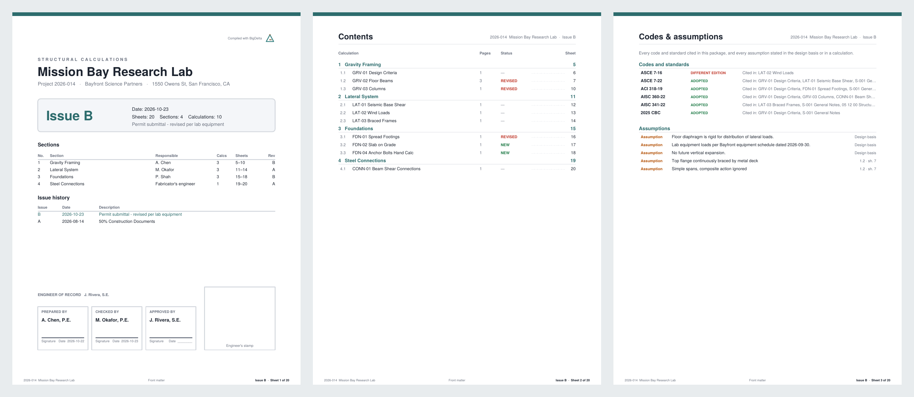
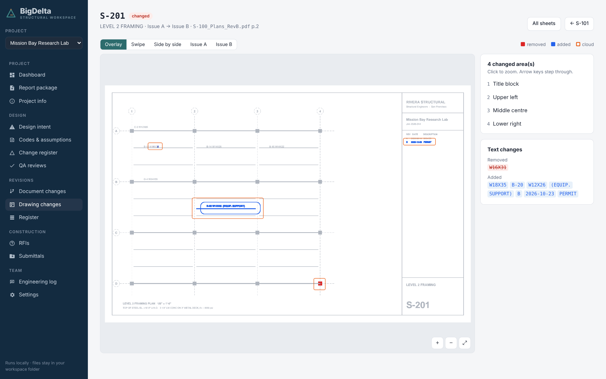
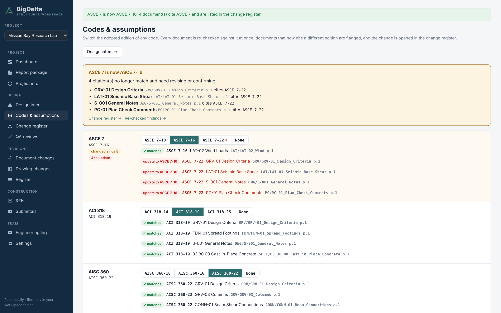
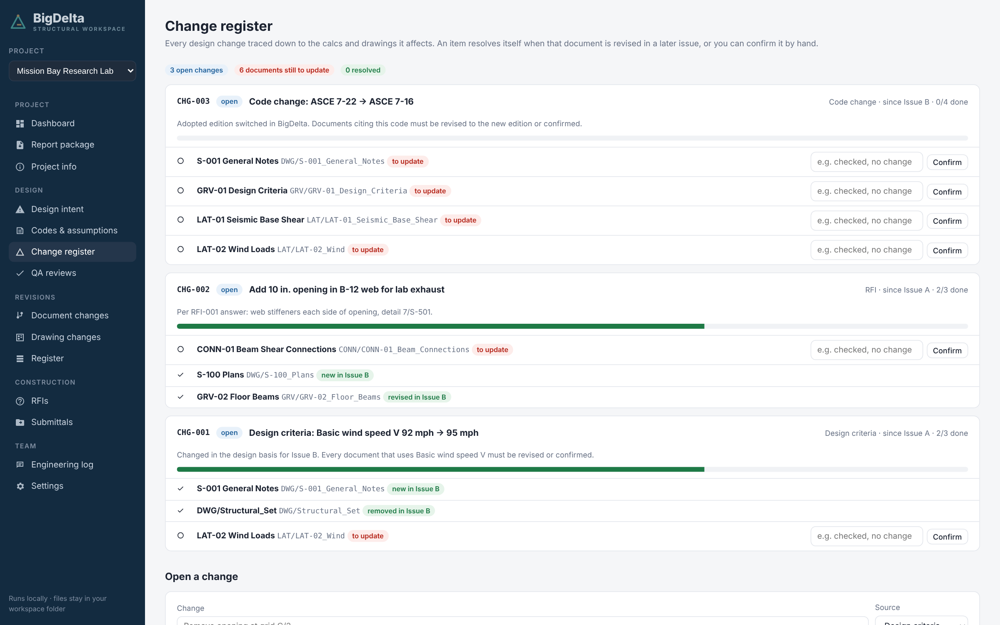

# BigDelta — 2:50 pitch script

Team: Owen Hodges · Robert Indoe · Ricky Swaim · Mel Agagas · JP Sandrock · Damian Valencia · Beth Kestner

The slides are an online deck; this file holds the spoken script with timings and the images used on the slides.

## 1. One workspace for every calc, drawing and revision

0:00–0:12 (12 s). Hi, we’re Team BigDelta. Structural engineers spend hours assembling calc packages by hand and chasing revisions across calcs, drawings and specs. BigDelta is one workspace that does that for you — think Procore, built for structural engineers.

## 2. Today a calc package is built by hand
0:12–0:32 (20 s). Here’s the workflow today. We print PDFs from RISA, ENERCALC, Mathcad and hand calcs. We rename them so they sort, merge them, then type the contents and bookmarks by hand. Then the plan checker sends comments, new pages go in, and we renumber everything again. And through all of it, nothing checks that the calcs, drawings and specs still say the same thing.

## 3. BigDelta keeps the whole project in step

0:32–0:47 (15 s). BigDelta is a Python web app that runs locally and saves to the company server. Every project gets a dashboard: phase, milestones, open design errors, QA progress, RFIs and submittals — and you can switch between as many projects as you’re running.

## 4. Build the package your way

0:47–1:05 (18 s). Building the package: start from a template — steel and concrete, wood multifamily, retrofit, or your own — and remove the footing section if the project doesn’t need it. Drop in PDFs from any software, drag them into order, and when the plan checker asks for a new calc, insert it right after 1.2. The contents panel renumbers live.

## 5. Press compile. Get the finished package.

1:05–1:20 (15 s). Hit compile and you get the finished book: cover sheet with the signature block, a table of contents where every line is a link, section title pages, bookmarks, and a revision summary that tags every changed sheet. When one calc says “per LAT-03”, we stamp the current sheet number next to it — so page references stay right after plan check.

## 6. See exactly what changed on every sheet

1:20–1:38 (18 s). For drawings, BigDelta matches sheets by their sheet number and compares them. Removed linework shows red, added shows blue, and every changed area is clouded. Here on S-201: beam B-12 went from W16X31 to W18X35, a new equipment beam was added, and a column was deleted. Overlay, swipe, or side by side.

## 7. It finds the contradictions between PDFs
1:38–1:58 (20 s). This is design intent. One design basis file holds the adopted codes, seismic and wind values, material strengths and soil bearing. BigDelta reads every calc, drawing and spec against it — and against each other. In our demo it found eight errors: the wrong SDS, an old ASCE 7 edition, bearing above the geotech limit, a connection designed for the old beam size, and drawings pointing at last revision’s specs.

## 8. Switch a code edition and see the impact

1:58–2:15 (17 s). Every code citation is listed with where it appears. Switch the adopted edition — here ASCE 7-22 back to 7-16 — and BigDelta re-checks everything instantly, highlights the four documents that now cite the wrong edition, and opens a change. Assumptions from the basis and from every calc are listed too, so they’re visible to the checker.

## 9. Every change traced to the sheets it touches

2:15–2:35 (20 s). Changes have to reach the calcs and drawings. When the wind speed or a code changes, BigDelta opens a change listing every document that uses it, and each one closes itself when that document is revised. Same for an RFI like a new beam opening. Around it: QA reviews and approvals, RFIs, submittals and material change requests, and an engineering log so lessons carry to the next project.

## 10. Built by
2:35–2:50 (15 s). BigDelta is built in Python, test-first, and runs locally so files stay on the company server. We’re Owen, Robert, Ricky, Mel, JP, Damian and Beth. Thank you.
