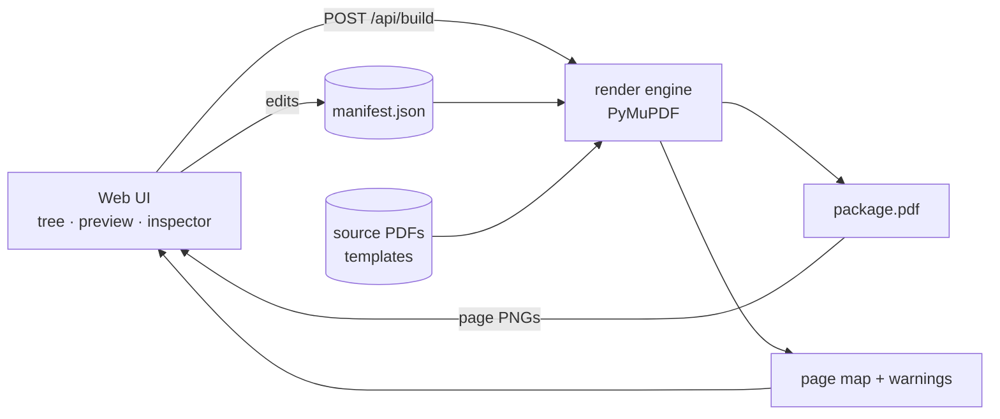

# Calc Compiler — Implementation Plan

NCSEA AEC Hackathon · Component 1 of 3 (Calc Compile)

## 1. Goal

Replace the manual calc-package workflow (print PDFs from several programs, rename files so they sort, merge, hand-build bookmarks and a table of contents, hand-number pages) with a UI-driven tool that compiles a finished, navigable calc package from a manifest.

**Wish list delivered by this component:**

- Cover sheet generation
- Section title (divider) pages
- Table of contents
- Signature blocks: prepared by / checked by / approved by
- PDF bookmarks
- Page headers and footers, with masking of source-program headers
- Page number references that update automatically ("see page 34" becomes "see page 47" when sheets are inserted)

**Demo promise:** Insert pages mid-package, click Build, and every page number, TOC entry, divider contents list, bookmark, and in-text page reference updates.

## 2. Scope

**In scope today**

- Ingest PDFs from ENERCALC, spreadsheet exports, and hand-calc scans
- Section tree with drag-to-reorder
- Manifest-driven render engine (PyMuPDF)
- Three-pane web UI: tree, page preview, inspector
- Header masking presets per source type
- Cover sheet and divider pages built on Excel-exported background templates
- TOC, bookmarks, clickable internal links
- Page references: tokens in app-generated text, plus box-and-stamp references on source pages
- Warnings panel

**Out of scope today**

- Revision tracking, issue snapshots, cross-version references (Component 2)
- Design-intent checks (Component 3)
- Load-path dependency graphs (tabled)
- Cryptographic digital signatures (the signature block only provides a stamp/signature area)
- Undo, user accounts, multi-user editing
- OCR of handwritten page references (references on scans are boxed manually)

## 3. Architecture



Core rules:

1. **The manifest is the single source of truth.** Every UI action only edits the manifest.
2. **Only the render engine touches PDFs.** `build(manifest)` returns the package PDF, a page map, and warnings.
3. **The UI displays results.** It shows page images served by the backend and never parses PDFs itself.

### Stack

| Layer | Choice | Notes |
|---|---|---|
| Backend | Python 3.11+, FastAPI, Uvicorn | |
| PDF engine | PyMuPDF (`pymupdf`) | Merge, overlay, text, links, bookmarks, page rendering |
| Data models | Pydantic | Manifest validation |
| Front end | Plain HTML/JS + SortableJS (CDN) | Swap in React only if a teammate is fluent |
| Preview | PNGs from `page.get_pixmap(dpi=…)` | No PDF.js needed |

## 4. Repository Layout

```
calc-compiler/
  backend/
    app.py              FastAPI routes
    manifest.py         Pydantic models, load/save, validation
    render/
      pipeline.py       build(manifest) orchestration
      layout.py         page planning and page map (no drawing)
      sources.py        normalize source pages, apply masks
      frontmatter.py    cover sheet, TOC
      dividers.py       section title pages
      textpages.py      app-generated notes pages
      stamp.py          header strip, footer, signature fields
      refs.py           token and box reference resolution
      nav.py            bookmarks, internal links
  frontend/
    index.html
    app.js
    styles.css
  projects/
    sample/
      manifest.json
      sources/          ENERCALC, spreadsheet, scan PDFs
      templates/        cover_bg.pdf, divider_bg.pdf
      out/              package.pdf, page PNG cache
  tests/
    test_layout.py
    test_build.py
  PLAN.md
```

## 5. Manifest Schema

```json
{
  "schema_version": 1,
  "project": {
    "name": "Example Fire Station",
    "address": "123 Main St, Anytown, CA",
    "job_number": "26-0123",
    "client": "City of Anytown",
    "jurisdiction": "City of Anytown Building Division",
    "permit_number": ""
  },
  "issue": { "version": "V1", "date": "2026-10-27", "description": "Permit submittal" },
  "issue_history": [
    { "version": "V1", "date": "2026-10-27", "description": "Permit submittal" }
  ],
  "people": {
    "OW": { "name": "Engineer A", "initials": "OW", "role": "Project Engineer" },
    "JS": { "name": "Engineer B", "initials": "JS", "role": "Checker" },
    "PR": { "name": "Engineer C", "initials": "PR", "role": "Principal / EOR" }
  },
  "approved_by": "PR",
  "settings": {
    "page_size": "letter",
    "front_matter_numbering": "none",
    "body_numbering": "continuous",
    "header_band_in": 0.6,
    "footer_band_in": 0.4
  },
  "templates": {
    "cover":   { "background": "templates/cover_bg.pdf",   "fields": { "project.name": { "rect": [72, 200, 540, 230], "size": 20 } } },
    "divider": { "background": "templates/divider_bg.pdf", "fields": { "section.number": { "rect": [72, 250, 540, 280], "size": 28 } },
                 "contents_rect": [90, 340, 520, 700] }
  },
  "mask_presets": {
    "enercalc":    { "rects": [[0, 0, 612, 64]] },
    "spreadsheet": { "rects": [[0, 0, 612, 50]] },
    "scan":        { "rects": [] }
  },
  "sections": [
    {
      "id": "sec-criteria",
      "number": "1",
      "title": "Design Criteria",
      "items": [
        {
          "id": "loads-roof",
          "type": "pdf",
          "title": "Roof Dead and Live Loads",
          "element": "",
          "source": { "file": "sources/roof_loads.pdf", "kind": "spreadsheet", "pages": "all" },
          "mask_preset": "spreadsheet",
          "prepared_by": "OW", "prepared_date": "2026-10-20",
          "checked_by": "JS",  "checked_date": "2026-10-22",
          "refs": []
        }
      ]
    },
    {
      "id": "sec-gravity",
      "number": "2",
      "title": "Gravity Design",
      "items": [
        {
          "id": "beam-B4",
          "type": "pdf",
          "title": "Beam B-4 at Grid C",
          "element": "B-4",
          "source": { "file": "sources/B4_enercalc.pdf", "kind": "enercalc", "pages": "all" },
          "mask_preset": "enercalc",
          "prepared_by": "OW", "prepared_date": "2026-10-21",
          "checked_by": null,  "checked_date": null,
          "refs": [
            { "id": "ref-1", "page_index": 0, "rect": [430, 512, 470, 528],
              "target": "loads-roof", "format": "{page}", "font_size": 9 }
          ]
        },
        {
          "id": "note-gravity",
          "type": "text",
          "title": "Gravity Design Notes",
          "body": "Roof loads per page {{page:loads-roof}}. Beam B-4 begins on page {{page:beam-B4}}.",
          "prepared_by": "OW", "checked_by": "JS"
        }
      ]
    }
  ]
}
```

### Field notes

- **Coordinates** are PDF points (1/72 in) on the *output* page, origin at the top-left (PyMuPDF convention). Template field positions, mask rectangles, and reference boxes all use this one coordinate space.
- **`type: "pdf"`** items come from source files. **`type: "text"`** items are app-generated notes pages, capped at one page and supporting `{{page:<item-id>}}` tokens.
- **`refs[].page_index`** is zero-based within the item. A reference resolves to the first body page of the `target` item.
- **`refs[].format`** allows output like `"{page}"` or `"p. {page}"`.
- **`people`** keys are initials and are referenced by the signature fields.
- **Seed order from filenames:** on upload, a leading number prefix (`03_B4.pdf`) sets the initial position in the section.

## 6. Render Engine

### Pipeline

`build(manifest) -> BuildResult(pdf_path, page_map, warnings)`

**Pass 1: Plan the layout (no drawing).** Count pages for every element:

- cover: 1 page
- TOC: `ceil(rows / rows_per_page)` pages
- divider: 1 page per section (contents list capped to fit)
- PDF item: source page count
- text item: 1 page

From the counts, build the page map. **Front matter (cover + TOC) is unnumbered; body numbering starts at 1 after it.** This keeps TOC length from shifting body page numbers, so there's no render-measure-rerender loop.

```
physical_index = front_matter_count + body_page - 1
```

**Pass 2: Build the document.**

1. **Normalize source pages.** For each source page, create a fresh letter-size page and place the source with `show_pdf_page(rect, src_doc, pno)`. This handles rotated scans and odd page sizes (11×17 is scaled to fit) and gives every page the same coordinate space as the UI preview. Keep the header and footer bands clear by placing the source into the body rect.
2. **Apply masks.** Draw opaque white rectangles from the item's mask preset (`page.draw_rect(rect, color=None, fill=(1, 1, 1))`).
3. **Generate dividers.** Place `divider_bg.pdf` with `show_pdf_page`, then overlay the section number, title, project info, and a contents list (item title, element, page number) inside `contents_rect`.
4. **Generate text pages.** Resolve `{{page:…}}` tokens from the page map, then `insert_textbox`.
5. **Generate the TOC.** Section rows and item rows with dot leaders and page numbers.
6. **Generate the cover.** Background template plus project fields, issue table, approved-by line, and an empty stamp/signature box.
7. **Stamp headers and footers** on every body page:
   - Header strip: project name, job number, item title / element, `By: OW 10/21/26`, `Chk: JS 10/22/26`
   - Footer: `Page 12 of 148` and the issue version/date
8. **Stamp references.** For each `ref`, draw a white rectangle over `rect`, then insert the resolved number, with font size from `ref.font_size` or derived from box height.
9. **Add navigation.**
   - Bookmarks: `doc.set_toc([[level, title, physical_page_1based], …])` built from the tree (level 1 = section, level 2 = item).
   - Links: `page.insert_link({"kind": fitz.LINK_GOTO, "from": rect, "page": target_index})` on TOC rows, divider contents rows, and every resolved reference.
10. **Save** with `doc.save(path, garbage=3, deflate=True)`.

### Build result

```json
{
  "pdf_path": "out/package.pdf",
  "front_matter_pages": 3,
  "page_count": 151,
  "page_map": [
    { "physical": 0, "kind": "cover" },
    { "physical": 1, "kind": "toc" },
    { "physical": 3, "body_page": 1, "kind": "divider", "section_id": "sec-criteria" },
    { "physical": 4, "body_page": 2, "kind": "item", "item_id": "loads-roof", "item_page": 0 }
  ],
  "item_first_page": { "loads-roof": 2, "beam-B4": 34 },
  "warnings": [
    { "level": "warn", "code": "NO_CHECKER", "item_id": "beam-B4", "message": "Beam B-4 has no checker assigned" }
  ]
}
```

### Warnings

| Code | Condition |
|---|---|
| `NO_CHECKER` | Item has no `checked_by` |
| `NO_PREPARER` | Item has no `prepared_by` |
| `BAD_REF_TARGET` | Reference or token points to a missing item |
| `EMPTY_SECTION` | Section has no items |
| `MISSING_SOURCE` | Source file not found |
| `DIVIDER_OVERFLOW` | Divider contents list truncated |
| `NO_APPROVER` | Cover has no approved-by |

### Known compromise

Masks and reference stamps are overlays, so the original text is still underneath (it can show up in PDF text search or copy/paste). That's acceptable for the demo. Stretch fix: redact on the source page (`add_redact_annot` + `apply_redactions`) before it is placed.

## 7. API

| Method | Route | Purpose |
|---|---|---|
| GET | `/api/manifest` | Load the manifest |
| PUT | `/api/manifest` | Save the full manifest (validated) |
| POST | `/api/upload` | Multipart PDF(s) + `section_id`; adds items, seeds order from filename prefix |
| POST | `/api/templates/{cover\|divider}` | Upload a background template PDF |
| POST | `/api/build` | Run the pipeline; returns `BuildResult` |
| GET | `/api/pages/{physical}.png?dpi=60` | Rendered page image (thumbnail or full view) |
| GET | `/api/export.pdf` | Download the latest package |

The backend autosaves the manifest to disk on every PUT. Cache page PNGs per build ID so the preview doesn't re-render unchanged pages.

## 8. UI Specification

### Layout

```
┌──────────────────────────────────────────────────────────────────┐
│ Project ▾   Templates ▾                   [Build]  [Export PDF]  │
├──────────────┬───────────────────────────────────┬───────────────┤
│ PACKAGE TREE │ PAGE PREVIEW                      │ INSPECTOR     │
│              │                                   │               │
│ ▾ 1 Criteria │  ┌────┐ ┌────┐ ┌────┐ ┌────┐      │ Title         │
│   Roof loads │  │ 1  │ │ 2  │ │ 3  │ │ 4  │      │ Element       │
│ ▾ 2 Gravity  │  └────┘ └────┘ └────┘ └────┘      │ Source kind   │
│   B-4  ⚠     │                                   │ Mask preset   │
│   Notes      │  [Thumbnails | Page]  [Mask][Ref] │ Prepared by   │
│ + Section    │                                   │ Checked by    │
│ (drop PDFs)  │                                   │ References    │
├──────────────┴───────────────────────────────────┴───────────────┤
│ WARNINGS (3): B-4 has no checker · …                             │
└──────────────────────────────────────────────────────────────────┘
```

### Panes

**Package tree (left)**
- Sections and items with drag-to-reorder (SortableJS, nested lists)
- Drop PDFs onto a section to add them
- Add, rename, and delete sections; add text (notes) items
- Badges for warnings on each item
- Multi-select (Shift/Ctrl-click) for bulk edits

**Page preview (center)**
- Thumbnail grid and single-page view, showing final body page numbers
- Selecting a tree item scrolls to its pages; clicking a page selects its item
- **Mask tool:** drag a rectangle on a page and save it to a preset for that source kind
- **Reference tool:** drag a box over a page number, pick the target item from a dropdown, and the box is saved as a `ref`

**Inspector (right)**
- Item: title, element tag, source kind, mask preset, prepared/checked by with dates, list of references (edit target, delete)
- Section: number, title
- Text item: body editor with an "insert page reference" picker that inserts `{{page:item-id}}`
- Multi-select: bulk set checked-by, prepared-by, mask preset

**Top bar**
- Project dialog: project info, issue info, people, approved by
- Templates dialog: upload cover and divider backgrounds; edit field positions
- Build and Export

**Warnings bar (bottom)**
- Lists warnings from the last build; clicking one selects the item

### Template field positions

Field positions on the Excel-exported backgrounds need coordinates. Fastest options, in order:

1. Measure once in Bluebeam (points from the top-left) and hard-code them in the sample manifest.
2. Stretch: in the Templates dialog, click a field name, then drag its box on the template preview.

## 9. Team Roles

| Role | Owns |
|---|---|
| **Engine** | `manifest.py`, `render/*`, tests, `/api/build` |
| **UI** | `frontend/*`, all other API routes, preview tools |
| **Shared (first 30 min)** | Manifest schema, sample manifest, sample PDFs |

If one person covers both roles, follow the milestones in order and skip the stretch items.

## 10. Timeline and Milestones

Hours are relative to kickoff. Compress them to fit the demo deadline.

| Time | Milestone | Done when |
|---|---|---|
| 0:00–0:30 | **M0 Kickoff** | Schema agreed; sample manifest committed; 5–10 real sample PDFs collected (ENERCALC, spreadsheet export, scan); cover and divider backgrounds exported from Excel |
| 0:30–2:00 | **M1 Engine core** | CLI `python -m backend.render.pipeline sample` merges in order, normalizes pages, stamps body page numbers, writes bookmarks |
| 0:30–2:00 | **M1 UI shell** | Three panes render from the sample manifest; tree reorders and saves via PUT |
| 2:00–2:30 | **M2 Integration** | Build button calls the engine; preview shows real page PNGs; click-to-select works both ways |
| 2:30–4:00 | **M3 Package features** | Masks, header strip with signature fields, footer, dividers with contents list, TOC, cover |
| 4:00–5:00 | **M4 References** | `{{page:…}}` tokens in text items; box references on source pages; clickable links; reference tool in UI |
| 5:00–5:30 | **M5 Warnings + polish** | Warnings bar, multi-select bulk edit, upload with filename-prefix ordering |
| 5:30–6:00 | **M6 Freeze** | Feature freeze, demo project prepared, demo rehearsed twice, backup exported PDF and screen recording saved |

**Rule:** if a milestone slips by more than 30 minutes, cut the lowest-priority item in it rather than pushing later milestones.

## 11. Demo Script (~3 minutes)

1. **The pain (20 s):** "Today: print from four programs, rename files so they sort, merge, hand-build bookmarks and the TOC, hand-number pages. Then plan check comes back."
2. **Compile (40 s):** Drop in ENERCALC outputs, a spreadsheet export, and hand-calc scans. Drag them into sections. Assign the checker to 20 items at once. Build. Show the cover, TOC, dividers, header strips, and bookmarks.
3. **The revision moment (60 s):** "Plan check asked for a revised beam." Drop a 13-page revised calc ahead of the loads section and click Build. Show:
   - TOC and divider page numbers updated
   - "Page 34 of 148" became "Page 47 of 161"
   - A notes page that said "see page 34" now says "see page 47"
   - A boxed reference on a **hand-calc scan** updated too, and it's clickable
4. **Quality (20 s):** Warnings bar flags the item with no checker; click it, assign, rebuild, and the warning clears.
5. **Close (20 s):** "Hours of collation become a 2-second build. Next: revision tracking and design-intent checks run on this same manifest."

## 12. Risks and Mitigations

| Risk | Mitigation |
|---|---|
| Rotated or odd-sized scans misplace overlays | Normalize every page with `show_pdf_page` onto letter pages first (step 1) |
| Reference stamp font doesn't match surrounding text | Use Helvetica; size from box height; white box hides the original |
| Large scans slow builds and previews | Downsample scans on upload; cache PNGs; preview at 60 dpi |
| Template field coordinates take too long | Hard-code measured coordinates; the drag-to-position UI is stretch |
| Divider contents overflow one page | Cap rows, add "continued in TOC", emit `DIVIDER_OVERFLOW` |
| Drag-and-drop tree eats UI time | Fallback: up/down arrow buttons on each item |
| Integration surprises late in the day | Integrate at M2 even if ugly; engine stays runnable from the CLI |
| Live demo failure | Pre-built backup PDF and a screen recording |

## 13. Acceptance Checklist

- [ ] Sources from ENERCALC, a spreadsheet export, and a scan compile into one PDF in tree order
- [ ] Source headers are masked by preset
- [ ] Every body page has a header strip with project, job number, item title, by/chk with dates
- [ ] Every body page has "Page X of Y"
- [ ] Cover sheet shows project info, issue table, approved-by, and a stamp box
- [ ] Each section has a divider with a live contents list
- [ ] TOC lists sections and items with correct page numbers and clickable rows
- [ ] Bookmarks mirror the tree
- [ ] `{{page:…}}` tokens resolve correctly
- [ ] Box references on source pages (including a scan) resolve and are clickable
- [ ] Inserting pages and rebuilding updates all of the above
- [ ] Warnings bar reports missing checker, bad reference target, missing source

## 14. Interfaces to the Other Components

- **Revision tracking (Component 2)** consumes `manifest.json` and `BuildResult.page_map` to snapshot an issued version and to resolve cross-version references. Calc compile keeps item IDs stable across edits so versions can be compared.
- **Design intent (Component 3)** consumes an optional `extracted` object on each item (member size, D/C ratio, code edition, load values). Calc compile reserves the field; the ENERCALC parser is a stretch item for this component.

## 15. Stretch Goals

1. True redaction of masked and referenced text before placement
2. Drag-to-position template fields in the UI
3. Section-prefixed numbering option (G-12, L-5)
4. Auto-detect "see page NN" patterns in text-based source PDFs and propose references
5. Vision model suggests titles and element tags for scanned hand-calc pages
6. ENERCALC result extraction into `extracted` for Component 3
